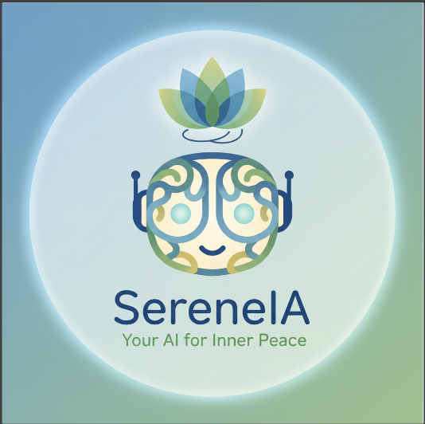
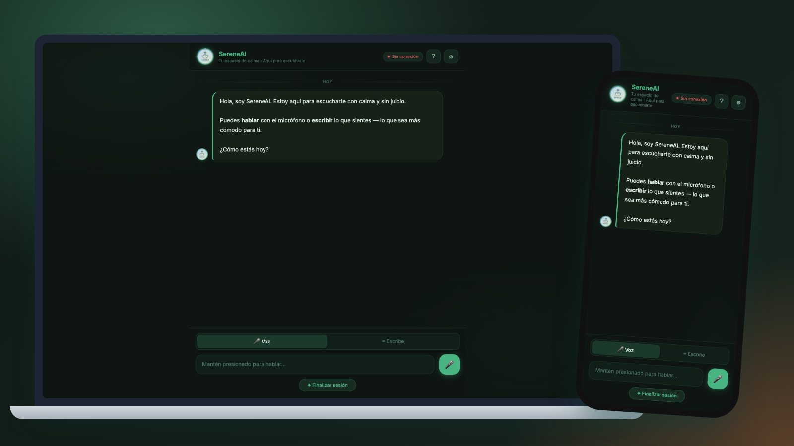
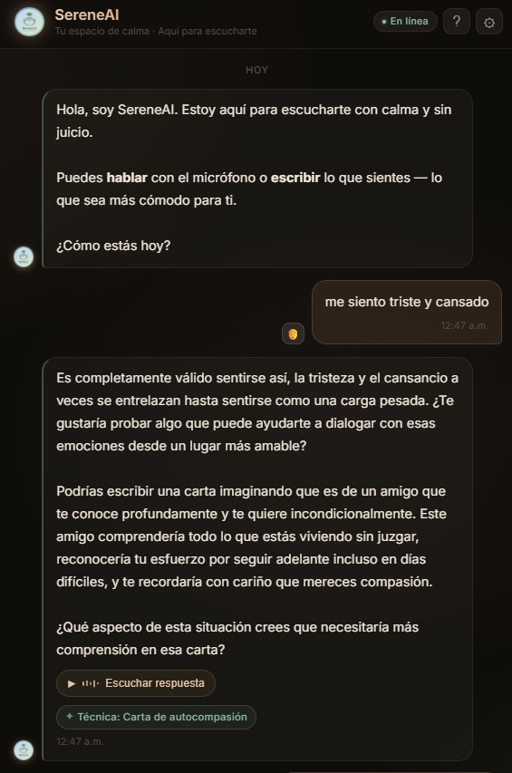
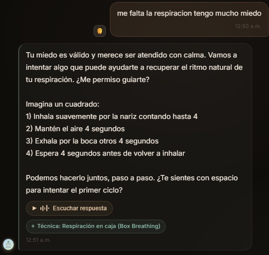
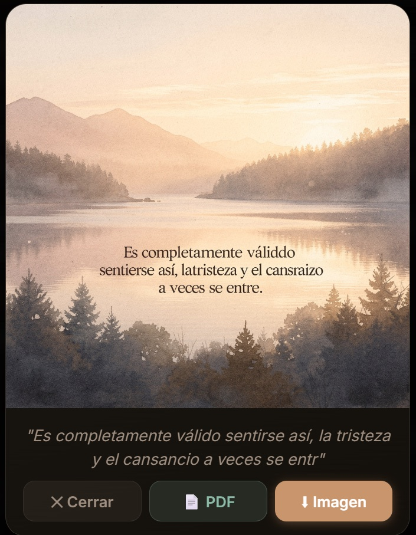
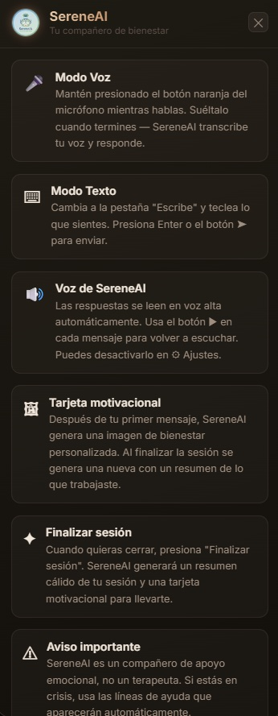
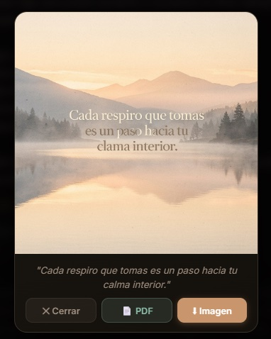
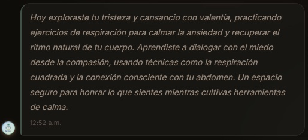
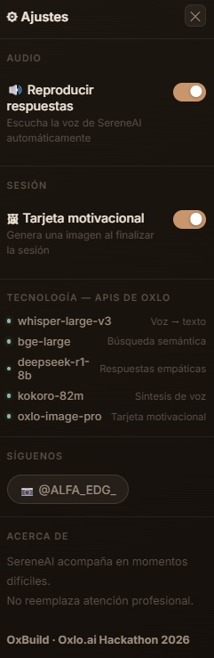
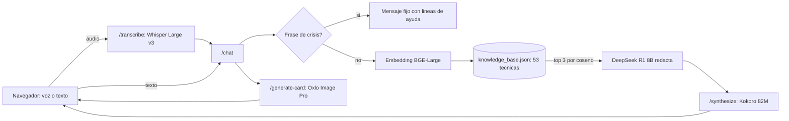

<div align="center">



# SereneAI 🌿

### "Habla. Te escucho. Respiremos juntos."

Compañero de bienestar emocional por voz: te escucha, responde con empatía, te propone una técnica real de bienestar y, si detecta una crisis, te da líneas de ayuda.

[](https://serene-ai-seven.vercel.app/)
[](#-estado-del-proyecto)
[](https://youtu.be/CDG0c7wVv3M)
[](#-hackathon)


<br/>



**[▶ Abrir el frontend](https://serene-ai-seven.vercel.app/)** · **[Ver el video demo](https://youtu.be/CDG0c7wVv3M)** · **[Cómo funciona](#-cómo-funciona)** · **[Correrlo local](#-correrlo-en-tu-compu)**

</div>

> [!WARNING]
> **El backend ya no está en línea.** El frontend en Vercel carga, pero el servidor de Railway responde 404, así que la app muestra **"Sin conexión"** y no puede transcribir, responder ni generar tarjetas. Las capturas de la galería son de abril de 2026, cuando el backend funcionaba; el [video demo](https://youtu.be/CDG0c7wVv3M) muestra el flujo completo. Para probarlo hoy hay que correr el backend local con una API key de Oxlo.ai.

---

## 🎯 El problema

Cuando alguien se siente mal, el primer momento de necesidad casi nunca coincide con una cita con un profesional. Muchas personas no tienen con quién hablar en ese momento, y escribir o hablar con un chatbot genérico puede dar respuestas vacías o, peor, minimizar lo que sienten.

## 💡 La solución

SereneAI es un espacio para **hablar (o escribir) sobre cómo te sientes** y recibir:

- **Apoyo emocional inmediato**, leído en voz alta con voz sintetizada.
- **Una técnica de bienestar concreta**, recuperada por búsqueda semántica (RAG) de una base de **53 técnicas**; el nombre de la técnica aparece como chip en el chat.
- **Detección de crisis antes del modelo**: si el mensaje contiene una de **35 frases clave**, la respuesta es un texto fijo (no generado) con líneas de ayuda en México.
- **Una tarjeta motivacional** con imagen generada, descargable como imagen o PDF, y un resumen de la sesión al cerrar.

```
 Persona:   "me falta la respiración, tengo mucho miedo"
 SereneAI:  "Tu miedo es válido y merece ser atendido con calma… Imagina un cuadrado:
             inhala contando hasta 4, mantén 4, exhala 4, espera 4…"
            [▶ Escuchar respuesta]   [✦ Técnica: Respiración en caja (Box Breathing)]
```

No reemplaza la terapia profesional: la complementa en el primer momento de necesidad.

## 📸 Capturas (abril 2026, con el backend en línea)

<table>
<tr>
<td width="50%"><p align="center"><sub>Respuesta empática con botón de audio y chip de la técnica recuperada.</sub></p></td>
<td width="50%"><p align="center"><sub>La técnica viene de la base de conocimiento, no se la inventa el modelo.</sub></p></td>
</tr>
<tr>
<td width="50%"><p align="center"><sub>Tarjeta motivacional generada, descargable como imagen o PDF.</sub></p></td>
<td width="50%"><p align="center"><sub>Guía de uso con el aviso de que no es una terapeuta.</sub></p></td>
</tr>
<tr>
<td width="50%"><p align="center"><sub>Otra tarjeta generada.</sub></p></td>
<td width="50%"><br/><p align="center"><sub>Resumen de la sesión y ajustes.</sub></p></td>
</tr>
</table>

## 🧠 Cómo funciona



**Pipeline RAG**

1. Al arrancar el servidor, los embeddings de las 53 técnicas se generan en segundo plano (`data/embeddings.json`).
2. Por cada mensaje: embedding → similitud coseno → top 3 técnicas → contexto inyectado al modelo.
3. El modelo solo usa técnicas recuperadas de la base; el nombre de la principal se muestra como chip.

### Modelos de Oxlo utilizados

| Modelo | Función |
|:--|:--|
| `whisper-large-v3` | Voz → texto (WebM / MP4 / OGG) |
| `bge-large` | Embeddings de 1 024 dimensiones para RAG |
| `deepseek-r1-8b` | Respuestas empáticas y resumen de sesión |
| `kokoro-82m` | Síntesis de voz (TTS) |
| `oxlo-image-pro` | Tarjeta motivacional 1 024×1 024 |

### Endpoints de la API (`backend/main.py`)

| Método | Ruta | Descripción |
|:--|:--|:--|
| GET | `/health` | Estado: base cargada + embeddings en caché |
| POST | `/generate-embeddings` | Genera los embeddings de las 53 técnicas (incremental) |
| POST | `/transcribe` | Transcribe audio con Whisper Large v3 |
| POST | `/chat` | Pipeline completo: crisis → embedding → recuperación → LLM |
| POST | `/synthesize` | Texto → audio WAV (base64) con Kokoro 82M |
| POST | `/generate-card` | Imagen motivacional con Image Pro |
| POST | `/session-summary` | Resumen empático de la sesión |

## 🛡️ Seguridad y ética

- **Nunca diagnostica** ni recomienda medicamentos; el system prompt prohíbe minimizar el dolor de la persona.
- **Crisis primero:** la detección corre antes del modelo y la respuesta es fija, con estas líneas:
  - **Línea de la Vida:** 800 911 2000 (24 horas)
  - **SAPTEL:** 55 5259 8121 (24 horas)
  - **IMSS Salud Mental:** 800 890 0024 (lunes a viernes)
- La guía de uso de la app aclara que SereneAI es un compañero de apoyo, no una terapeuta.

## 🛠️ Stack

| Capa | Tecnología |
|:--|:--|
| Backend | Python 3.11 · FastAPI · Uvicorn · httpx · NumPy (similitud coseno) |
| Frontend | Un solo `index.html` (HTML, CSS y JavaScript, MediaRecorder API) |
| IA | Oxlo.ai: Whisper Large v3, BGE-Large, DeepSeek R1 8B, Kokoro 82M, Image Pro |
| Deploy | Frontend en Vercel · backend en Railway (hoy offline) |

## 🚀 Correrlo en tu compu

Necesitas Python 3.11+ y una API key de Oxlo.ai.

```bash
git clone https://github.com/ALFA117/SereneAI
cd SereneAI/backend
pip install -r requirements.txt
cp ../.env.example ../.env      # pon tu OXLO_API_KEY
uvicorn main:app --reload --port 8000
```

Los embeddings se generan solos al arrancar. Para el frontend:

```bash
python -m http.server 5500 --directory frontend   # http://localhost:5500
```

> El frontend apunta al backend de Railway (`API_URL` en `frontend/index.html`); para usarlo con tu backend local cambia esa constante a `http://localhost:8000`.

<details>
<summary><b>Variables de entorno y estructura</b></summary>

| Variable | Descripción |
|:--|:--|
| `OXLO_API_KEY` | API key de Oxlo.ai |
| `OXLO_BASE_URL` | URL base de la API (default: `https://api.oxlo.ai/v1`) |
| `CORS_ORIGINS` | Orígenes permitidos para CORS (separados por coma) |

```
SereneAI/
├── backend/
│   ├── main.py                    # FastAPI: 7 endpoints + pipeline RAG
│   ├── sereneai_system_prompt.py  # System prompt, detección de crisis, limpieza de R1
│   ├── requirements.txt
│   └── test_api.py
├── frontend/
│   ├── index.html                 # SPA: chat + voz + tarjeta + ayuda + ajustes
│   └── logo.png
├── data/
│   ├── knowledge_base.json        # 53 técnicas de bienestar
│   └── embeddings.json            # Generado al arrancar
├── docs/img/                      # Capturas
├── logo/SereneIA.png
├── Procfile · railway.json · .env.example
```

</details>

## 🏆 Hackathon

Desarrollado para el hackathon **OxBuild · Oxlo.ai · 2026**. Video del demo: [youtu.be/CDG0c7wVv3M](https://youtu.be/CDG0c7wVv3M).

---

<div align="center">


**Un primer momento de calma, no un reemplazo de la terapia.**

Hecho por **ALFA** · [@ALFA117](https://github.com/ALFA117) · Instagram [@alfa_edg.mou](https://www.instagram.com/alfa_edg.mou/)

</div>
